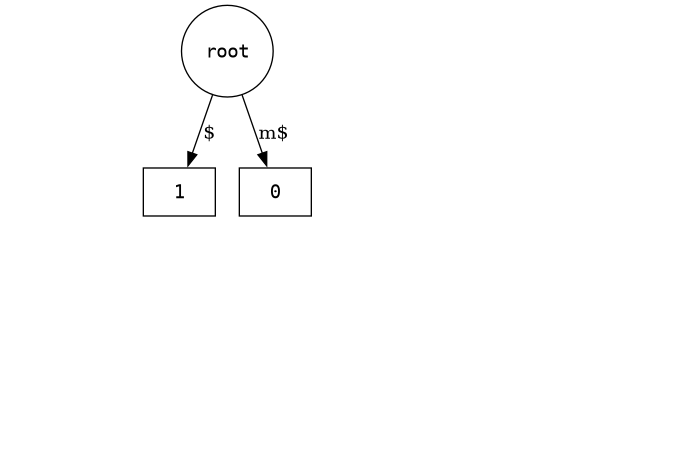

# substrings


Substrings prints the most commonly occurring substrings within the text.

```
./build/substrings --inline mississippi
```

```
is 2
iss 2
issi 2
si 2
ss 2
ssi 2
```

The program builds a suffix array of its input. 

<p align="center">
  
  <br>
  <em>The suffix tree of <code>mississippi</code>, one prefix at a time
  (<code>substrings --graph</code>; dashed red arrows are suffix links).</em>
</p>


By default it lists the repeated substrings, most frequent first. Bioinformatics does the same kind of
repeat finding to locate repeated regions in DNA. The same index answers
other questions as well:

- **Common words and phrases.** `--words` counts only whole words, so
  `--words --minlength 3` lists the most frequent three-word phrases
  ([example](#which-words-and-phrases-are-most-common)).
- **Counting and locating a pattern.** `--find` counts any string, phrase or
  escaped sequence instantly, and `--json` adds the position of every
  occurrence ([example](#how-often-does-a-word-or-phrase-occur)).
- **Duplicated text.** A large `--minlength` finds long passages that occur
  more than once: copy-pasted paragraphs, boilerplate, repeated log lines or
  duplicated code ([example](#what-are-the-longest-passages-that-repeat)).
  `scripts/compare.py` finds the passages two different texts share, such as
  quotations ([example](#find-the-passages-two-texts-share)).
- **Any command's output.** Input can come from a pipe, so `ls`, logs or
  CSV columns can be analyzed directly
  ([example](#analyze-the-output-of-another-command)).
- **Compressibility.** `--lz77` and `--bwt` show how repetitive a text is:
  the fewer LZ77 phrases or BWT runs, the better it compresses
  ([example](#how-compressible-is-a-text)).
- **Unique fingerprints.** `--shortest-unique` lists the shortest substrings
  that occur exactly once, which are the shortest keys that each identify
  one position in the text ([example](#find-the-shortest-unique-substrings)).
- **Palindromes.** `--palindrome` lists the longest palindromes
  ([example](#find-palindromes)).
- **Learning how suffix structures work.** `--view-internal-tables`, `--bwt`
  and `--graph` show the suffix array, LCP array, Burrows–Wheeler matrix and
  suffix tree of small inputs, such as the animation below
  ([example](#look-inside-the-suffix-array)).


It is written in C++23, works on raw bytes but never splits a UTF-8
character in its results, and is reasonably fast: the complete works of Shakespeare
(5.6 MB) are indexed and ranked in about half a second. Suffix array, PLCP and
LCP construction is done by [libsais](https://github.com/IlyaGrebnov/libsais),
parallelized with OpenMP when available.

- [Quick start](#quick-start)
- [Cookbook](#cookbook)
- [Reference](#reference)
- [Build](#build) · [Test](#test) · [Install](#install) · [Layout](#layout)

## Quick start

```bash
cmake -B build -S . -DCMAKE_BUILD_TYPE=Release
cmake --build build -j
./build/substrings --inline mississippi
```

This lists every substring of at least two bytes that occurs more than once, most
frequent first, ties in alphabetical order. See [Build](#build) for compiler
requirements, and [Install](#install) for the man page and shell completions.

## Cookbook

The recipes below use short words and
[`pg100.txt`](https://www.gutenberg.org/ebooks/100), Project Gutenberg's
*Complete Works of William Shakespeare*. All outputs are real.

Input comes from a file (`substrings FILE` or `-i FILE`), from stdin, or with
`--inline`, from the argument itself (`substrings --inline banana`); results
go to the terminal (through a pager, like git) or to `-o FILE`.

### What repeats in a text?

```
$ substrings --inline --minlength=1 mississippi
i 4
s 4
is 2
iss 2
issi 2
p 2
si 2
ss 2
ssi 2
```

`--minlength` sets the shortest length listed (default 2 bytes). Every
substring of `i`'s and `s`'s that repeats is here: a suffix array lists them
all without ever generating the quadratically many substrings of the text.

### What are the most frequent substrings of a book?

```
$ substrings -i pg100.txt --top 5
\r\n 196395
e  130875
 t 108889
th 105156
he 85840
```

`--top N` (or `-n N`) keeps the N most frequent. The winner is the Windows
line break. On a terminal, line breaks, tabs and invisible characters are
shown escaped so every result stays on one line; into a file or a pipe they
are written raw unless you pass `--escape`.

### What are the longest passages that repeat?

Raise `--minlength` to skip the short stuff:

```
$ substrings -i pg100.txt --minlength 40 --top 3 --escape
[_Exeunt._]\r\n\r\n\r\n\r\n\r\nACT IV\r\n\r\nSCENE I.  17
\r\n\r\n\r\n\r\n\r\nContents\r\n\r\n ACT I\r\n Scene I.  15
[_Exeunt._]\r\n\r\n\r\n\r\n\r\nACT II\r\n\r\nSCENE I.  14
```

### Which words and phrases are most common?

`--words` lists only whole words and phrases, and counts only whole-word
occurrences (`the` inside `other` doesn't count). `--minlength` then counts
words:

```
$ substrings -i pg100.txt --words --top 5
the 25743
I 23861
and 20184
to 17443
of 17301

$ substrings -i pg100.txt --words --minlength 3 --top 6
I pray you 246
I will not 221
I know not 168
I do not 163
A room in 160
A Room in 152
```

Long phrases turn up the stage directions:

```
$ substrings -i pg100.txt --words --minlength 6 --top 4 --escape
Alexandria. A Room in the Palace 16
A Room in the Palace.\r\n\r\n Enter 13
A room in Portia’s house 12
A room in the Countess’s 12
```

### How often does a word or phrase occur?

`--find` counts a pattern instead of listing repeats; repeat it for several
patterns. Matching is a binary search over the suffix array, so each query is
instant once the index is built.

```
$ substrings -i pg100.txt --find=Hamlet --find=Ophelia --find=Yorick
Hamlet 110
Ophelia 30
Yorick 2

$ substrings -i pg100.txt --find="To be, or not to be" --find="a horse"
To be, or not to be 1
a horse 34
```

Patterns accept `\n`, `\r`, `\t`, `\\` and `\0` escapes, so you can count
things like "a scene that opens with an entrance":

```
$ substrings -i pg100.txt --escape --find='\r\n\r\nEnter'
\r\n\r\nEnter 1221
```

With `--words`, only whole-word occurrences count. Matching is
case-sensitive:

```
$ substrings -i pg100.txt --words --find=love --find=hate --find=Rome --find=rome
love 2323
hate 183
Rome 403
rome 0
```

### Where does it occur?

`--json` prints JSON Lines, and a match lists the position (in characters)
of every occurrence:

```
$ substrings -i pg100.txt --json --find=Yorick
{"type":"match","text":"Yorick","count":2,"pos":[1123818,1123955]}
```

### Feed results to other tools

JSON output works well with `jq`:

```
$ substrings -i pg100.txt --json --words --minlength 2 --top 5 | jq -r '"\(.count)\t\(.text)"'
1940	I am
1893	I’ll
1880	in the
1675	I have
1616	of the
```

Or shape the plain output with `--delimiter`, `--entry-delimiter` and
`--nocount`:

```
$ substrings -i pg100.txt --words --top 5 --delimiter='\t' > top-words.tsv
$ substrings -i pg100.txt --words --top 5 --nocount --entry-delimiter=', '
the, I, and, to, of,
```

### Analyze the output of another command

Anything on stdin works. What do the program names in `/usr/bin` have in
common?

```
$ ls /usr/bin | substrings --words --top 6 --escape
21 137
linux 76
llvm 74
21\nllvm 73
gnu 73
x86 73
```

### Find palindromes

```
$ substrings --inline --palindrome --top 1 "racecar level noon"
Length 7 at position 0: "racecar"
Length 7 at position 7: " level "
Length 4 at position 14: "noon"
```

`--palindrome` prints distinct maximal palindromes, longest first, then the
usual repeats (`--top 1` keeps those short here). Palindromes are exact
character for character, spaces and case included, and positions count
characters.

### Find the shortest unique substrings

The shortest substrings that occur exactly once, which are the shortest
"fingerprints" that identify a position in the text:

```
$ substrings --inline --shortest-unique --top 1 abracadabra
Length 1 at position 4: "c"
Length 1 at position 6: "d"
ab 2
```

### How compressible is a text?

`--lz77` prints the greedy LZ77 factorization: the fewest phrases where each
is a copy of earlier text (`src` is where it's copied from) or a single new
byte (`-`). The output is TSV, and escaped so the input can be rebuilt from
it.

```
$ substrings --inline --lz77 "how much wood would a woodchuck chuck"
pos	len	src	text
0	1	-	h
1	1	-	o
2	1	-	w
3	1	-	 
4	1	-	m
5	1	-	u
6	1	-	c
7	1	0	h
8	1	3	 
9	1	2	w
10	1	1	o
11	1	10	o
12	1	-	d
13	3	8	 wo
16	1	5	u
17	1	-	l
18	2	12	d 
20	1	-	a
21	5	8	 wood
26	2	6	ch
28	2	5	uc
30	1	-	k
31	1	19	 
32	5	26	chuck
# n=37 z=24 avg_len=1.54 literals=11 longest=5
```

The summary line is the interesting part for big inputs: Shakespeare is
5.6 million bytes in 622,031 phrases, 9 bytes per phrase on average.

```
$ substrings --lz77 -i pg100.txt | tail -1
# n=5638525 z=622031 avg_len=9.06 literals=111 longest=385
```

### See the Burrows–Wheeler transform

```
$ substrings --inline --bwt banana
i  Pos  F         L
0  6    $  banan  a
1  5    a  $bana  n
2  3    a  na$ba  n
3  1    a  nana$  b
4  0    b  anana  $ ◀
5  4    n  a$ban  a
6  2    n  ana$b  a

BWT    annb$aa
Index  4 (the row of the original text)
Runs   r=5 in n=7 characters, counting $ (n/r = 1.40)
```

The sorted rotations, with the first (F) and last (L) columns highlighted
on a terminal. Read down L for the BWT. For inputs over 1000 characters only
the index and the run count are printed; the fewer runs, the better the text
compresses with BWT-based compressors such as bzip2.

### Look inside the suffix array

```
$ substrings --inline --view-internal-tables banana
i  SA[i]  Rank[i]  PLCP[i]  LCP[i]  Sorted Suffix
0  5      3        0        0       a
1  3      2        3        1       ana
2  1      5        2        3       anana
3  0      1        1        0       banana
4  4      4        0        0       na
5  2      0        0        2       nana
```

`SA` lists the suffixes in sorted order, `Rank` is its inverse, and `LCP[i]`
is the length of the prefix that suffix `i` shares with the one above it.
Every repeat in the text is a run of rows with a large enough LCP: `ana`
occurs twice because rows 1–2 share 3 characters. Control characters are
shown as `␊`, `␛`…, invalid UTF-8 as `\xNN`, and the table is colored on a
terminal (`--color=always|never` to override).

### Draw the suffix tree

```bash
substrings --inline --graph banana                  # writes suffix_tree.dot
substrings --inline --dotfile=tree.dot mississippi  # or any file name
dot -Tsvg tree.dot -o tree.svg             # render with Graphviz
```

Edge labels longer than 16 bytes are shortened with `...`, and dashed red
edges are suffix links. Trees of inputs over 10 KB need `--force-graph`.
`animation/make_animation.sh WORD` renders the tree of every prefix of a word
as frames, which is how the animation at the top was made.

### Find the passages two texts share

`scripts/compare.py` (Python 3, no dependencies) prints every maximal run of
at least 8 words (`-w N`) found in both files, longest first, with `line:col`
for each occurrence. It compares words, so a quotation still matches across
different line breaks or punctuation:

```
$ scripts/compare.py essay.txt pg100.txt
# words	essay.txt	pg100.txt	passage
18	2:21	37281:1	To be, or not to be, that is the question: Whether tis nobler in the mind to suffer
```

`-i` ignores case, `-n N` keeps the N longest, `--json` prints JSON Lines.
It's a prototype for a future `substrings` option.

### Find what two texts both repeat

`scripts/join.py` is a short example of scripting `substrings`: it runs
`substrings --json` on each file and prints the repeats that both lists
share, with the count in each file. Other options go to `substrings` for both
files (use `=` for their values). Which phrases do *Hamlet* and *Macbeth*
both keep coming back to?

```
$ scripts/join.py --words --minlength=3 hamlet.txt macbeth.txt | head -7
# hamlet.txt	macbeth.txt	substring
14	12	A room in
12	13	I pray you
20	8	room in the
26	6	in the Castle
6	13	my good lord
13	5	My lord, I
```

Results are sorted by the smaller of the two counts. Only substrings that
repeat within each file are found; for text that occurs once in each, use
`compare.py` above.

## Reference

```
substrings [OPTIONS] [FILE]
substrings --inline [OPTIONS] TEXT
```

Input is read from the `FILE` argument or `-i FILE` (only one of them), else
stdin. `-` means stdin for both, and `-o -` means stdout. With `--inline`, the
argument is the input text itself. An argument that starts with `-` goes after
`--`: `substrings -- -notes.txt`, `substrings --inline -- -x-x-`.

| Option | Description |
|---|---|
| `-i FILE`, `--input=FILE` | Read input from FILE (`-` for stdin) |
| `--inline` | Take the argument as the input text instead of a file name |
| `-o FILE`, `--output=FILE` | Write output to FILE (`-` for stdout) |
| `-n N`, `--top=N` | Print at most N repeated substrings (default: 100,000) |
| `--minlength=N` | Minimum length in bytes, or in words with `--words` (default: 2 bytes, 1 word) |
| `--words` | Only whole words and phrases, in the repeats and `--find` (see below) |
| `--nocount` | Omit occurrence counts |
| `--delimiter=STR` | Separator between substring and count (default: space) |
| `--entry-delimiter=STR` | Separator between entries (default: `\n`) |
| `--find=PATTERN` | Print PATTERN and its number of occurrences instead of the repeats, in the same format. Repeatable |
| `--json` | Print the repeats, `--find` counts, palindromes and shortest unique substrings as JSON Lines (see below) |
| `--escape[=WHEN]` | Escape line breaks, tabs, control and invisible characters in the results (`\n`, `\t`, `\xNN`, `\uXXXX`, `\\`): `auto` (default, only on a terminal), `always` or `never` |
| `--palindrome` | Print distinct maximal palindromes, longest first (up to 1000) |
| `--shortest-unique` | Print every shortest substring that occurs exactly once (up to 1000). Lengths and positions count characters |
| `--lz77` | Print the greedy LZ77 factorization as TSV instead of the repeats (see below) |
| `--view-internal-tables` | Print the SA/Rank/PLCP/LCP tables and exit (control characters shown as `␊`, `␛`…, invalid UTF-8 as `\xNN`) |
| `--bwt` | Print the Burrows-Wheeler matrix of the input + `$` (sorted rotations, F and L columns highlighted) and the BWT, its row index and run count. The matrix is drawn for inputs up to 1000 characters; larger inputs get only the index and run count |
| `--graph` / `--dotfile=FILE` | Write the suffix tree (with suffix links) as Graphviz DOT |
| `--force-graph` | Allow `--graph` for inputs over 10 KB |
| `--color[=WHEN]` | Color the tables of `--view-internal-tables` and `--bwt`: `auto` (default), `always` (also `--color` alone) or `never` |
| `--no-pager` | Write to the terminal directly instead of through the pager |
| `--completions=SHELL` | Print a completion script for `bash`, `zsh` or `fish` |
| `--version` | Show version |
| `-h`, `--help` | Show usage |

Options with a value also take it as the next argument (`--top 20`, except
`--color`, which needs `=`). Unknown options are an error, with a suggestion
for near misses (`--palindrom` → `--palindrome`). Delimiters and `--find`
patterns accept `\n`, `\r`, `\t`, `\\` and `\0` escapes.

### Repeats

Output lists up to 100,000 repeated substrings (`--top`), sorted by
frequency then lexicographically. Substrings that would split a UTF-8
character are never listed, and don't count toward `--top`. On a terminal,
results are escaped so that a repeat containing a line break (the most
frequent one in most text files is `\n` or `\r\n`) stays on its own line;
into a pipe or file they are written raw unless `--escape` is given.
Selecting the top substrings takes O(n log n) time even for very repetitive
input.

When stderr is a terminal, a progress bar appears there if building the
suffix array takes longer than 0.3 seconds. Reading input typed at the
terminal prints a reminder that Ctrl-D ends it.

### Words and phrases

`--words` lists only repeats that start and end at a word boundary, and
counts only the occurrences where they do. `--minlength` then counts words.

A word is a run of letters and digits: ASCII letters and digits, and every
character from U+00C0 on except U+2000–U+2FFF (punctuation, quotes, dashes,
symbols). Whatever lies between words is kept in phrases as it is, so `don't`
is the words `don` and `t` and also the phrase `don't`, and `my lord` and
`my, lord` are different phrases. With `--find`, only whole-word occurrences
count.

### JSON output

`--json` prints one JSON object per line:

```
$ substrings --inline --json --palindrome --shortest-unique --top=1 banana
{"type":"palindrome","text":"anana","pos":1,"len":5}
{"type":"palindrome","text":"ana","pos":1,"len":3}
{"type":"unique","text":"b","pos":0,"len":1}
{"type":"repeat","text":"an","count":2}
$ substrings --inline --json --find=an banana
{"type":"match","text":"an","count":2,"pos":[1,3]}
```

`pos` and `len` count characters, and a `match` lists the position of every
occurrence. As in the plain output, palindromes and unique substrings over
80 characters are abbreviated in the middle, and at most 1000 of each are
printed; an `{"type":"omitted",...}` line counts the rest. Invalid UTF-8
becomes U+FFFD. `--nocount` and the delimiters are ignored, and `--json`
can't be combined with `--lz77`, `--bwt` or `--view-internal-tables`
(`--lz77` already prints TSV).

### LZ77

`--lz77` splits the input into the fewest phrases where each phrase is a
copy of text that starts earlier (it may overlap itself, as in `aaaa`) or a
single new byte. Output is one `pos`, `len`, `src`, `text` line per phrase
(byte offsets; `src` is `-` for a literal) and a final
`# n=… z=… avg_len=… literals=… longest=…` summary. The text column is
escaped reversibly (`\t`, `\n`, `\r`, `\\`, `\xNN` for other control bytes
and for UTF-8 split by a phrase boundary, `\uXXXX` for invisible
characters), so the input can be rebuilt from the output alone. The other
output options are ignored with `--lz77`, as with `--view-internal-tables`.

### Terminal output

When output goes to a terminal, `substrings` pipes it through a pager, as git
does: `$SUBSTRINGS_PAGER`, else `$PAGER`, else `less`. Unless `LESS` is set,
it is run with `LESS=FRX`, so output that fits on one screen is just printed,
colors pass through, and the screen isn't cleared afterwards. Set the pager to
`""` or `cat`, or pass `--no-pager`, to turn it off. Quitting the pager early
ends `substrings` with exit status 0.

Tables are colored only when written to a terminal, unless `--color=always`
is given. A non-empty `NO_COLOR` (see [no-color.org](https://no-color.org))
or `TERM=dumb` turns colors off in `auto` mode. Tables are fitted to
`$COLUMNS` if it is set, else to the terminal width, else to 80 columns;
`COLUMNS=200 substrings --view-internal-tables -i f.txt -o t.txt` writes wider
rows to a file.

## Build

### Requirements

| | |
|---|---|
| Compiler | GCC ≥ 14 or Clang ≥ 18 with C++23 library support (`<print>`, `<expected>`, `std::views::enumerate`) |
| CMake | ≥ 3.28 |
| git + network | on the first configure, to fetch libsais (see below) |
| OpenMP | optional: parallel suffix array construction |
| Google Test | optional: the unit tests are built only if it is found |
| OS | Linux or macOS. The code uses POSIX (`isatty`, `ioctl`, `posix_spawn`); see Windows below |

### Dependencies and the configure step

libsais is not part of this repository. The first `cmake -B <dir>` clones
libsais (pinned to tag `v2.10.4`) from GitHub into `<dir>/_deps/` and builds it
with `substrings`. Later configures of the same build directory reuse that copy, but
every new build directory clones it again.

To build without network access, point CMake at a local libsais checkout:

```bash
cmake -B build -S . -DFETCHCONTENT_SOURCE_DIR_LIBSAIS=/path/to/libsais
```

OpenMP is used when the compiler supports it; otherwise CMake warns
`OpenMP not found` and libsais runs single-threaded, with the same results.
`-DSUBSTRINGS_USE_OPENMP=OFF` turns it off explicitly.

### Linux

Install the tools (the second line is only for building with Clang):

```bash
# Debian / Ubuntu
sudo apt install build-essential cmake git libgtest-dev
sudo apt install clang libomp-dev
# Fedora
sudo dnf install gcc-c++ cmake git gtest-devel
sudo dnf install clang libomp-devel
# Arch
sudo pacman -S base-devel cmake git gtest
sudo pacman -S clang openmp
```

On Ubuntu 24.04 the default GCC 13 is too old; install `g++-14` and add
`-DCMAKE_CXX_COMPILER=g++-14` to the configure line.

Build with GCC (the default):

```bash
cmake -B build -S . -DCMAKE_BUILD_TYPE=Release
cmake --build build -j
```

Build with Clang in a separate directory:

```bash
cmake -B build-clang -S . -DCMAKE_BUILD_TYPE=Release \
      -DCMAKE_C_COMPILER=clang -DCMAKE_CXX_COMPILER=clang++
cmake --build build-clang -j
```

The executables are written to the build directory (`build/substrings`,
`build/substrings_tests`). Use `-DCMAKE_BUILD_TYPE=Debug` for a build to step
through in a debugger, and add `-G Ninja` for faster builds if Ninja is installed.

### macOS

Apple's Xcode Clang may lack some C++23 library features (`std::print`,
`views::enumerate`), depending on the Xcode version, and has no OpenMP. Homebrew's
LLVM is the reliable choice:

```bash
brew install cmake llvm libomp googletest
cmake -B build -S . -DCMAKE_BUILD_TYPE=Release \
      -DCMAKE_C_COMPILER="$(brew --prefix llvm)/bin/clang" \
      -DCMAKE_CXX_COMPILER="$(brew --prefix llvm)/bin/clang++" \
      -DOpenMP_ROOT="$(brew --prefix libomp)"
cmake --build build -j
```

`brew install gcc` and `-DCMAKE_CXX_COMPILER=g++-15` also works.

### Windows

Native Windows builds (MSVC, MinGW) are not supported yet, because `substrings`
uses the POSIX calls `isatty`, `ioctl` and `posix_spawn` for terminal
detection and the pager. Use
[WSL 2](https://learn.microsoft.com/windows/wsl/install) with an Ubuntu
distribution and follow the Linux instructions.

## Test

```bash
./build/substrings_tests      # or: ctest --test-dir build
```

If CMake did not find Google Test, `substrings_tests` is not built; install the
package listed above and configure again.

## Install

```bash
cmake --install build --prefix ~/.local    # or /usr/local with sudo
```

This installs `bin/substrings`, the man page (`man substrings`) and completion
scripts for bash, zsh and fish into the directories those shells load from
(`share/bash-completion/completions`, `share/zsh/site-functions`,
`share/fish/vendor_completions.d`). The scripts are generated at build time
by `substrings --completions=SHELL`. Without installing, load them into the
current shell:

```bash
source <(./build/substrings --completions=bash)    # bash or zsh
./build/substrings --completions=fish | source     # fish
```

## Layout

| File | Contents |
|---|---|
| `suffix_array.{h,cpp}` | `SuffixArray`: construction, repeated-substring enumeration, shortest unique substrings, pattern search |
| `suffix_tree.{h,cpp}` | Suffix tree built from SA + LCP, suffix links, DOT output |
| `lz77.{h,cpp}` | Greedy LZ77 factorization from the suffix array, TSV output |
| `palindromes.{h,cpp}` | Palindrome finder (rolling hash LCE over codepoints) |
| `table_viz.{h,cpp}` | Colored table dump of the internal arrays, Burrows-Wheeler matrix |
| `cli.{h,cpp}` | Argument parsing and `--help`, both from one table of options |
| `completions.{h,cpp}` | bash, zsh and fish completion scripts generated from that table |
| `substrings.1` | Man page (mdoc) |
| `terminal.{h,cpp}` | Color and width decisions, the pager |
| `utf8.h` | UTF-8 ⇄ UTF-32 conversion, invisible-character table, reversible escaping, abbreviation of long strings |
| `main.cpp` | Wires input → `SuffixArray` → output |
| `scripts/compare.py` | Shared passages of two texts (prototype, Python) |
| `scripts/join.py` | Repeats two texts share, by scripting `substrings --json` (example, Python) |
| `docs/animation.webp` | The suffix tree animation above |

## License

MIT, see [LICENSE](LICENSE). libsais, which is fetched at build time, is
licensed under Apache 2.0.

## AI disclaimer

Most parts were written with AI, I try to find time to figure out neater data structures and internal apis.
